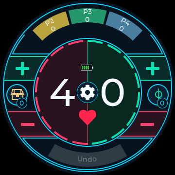
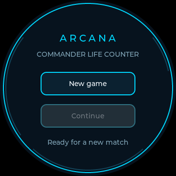
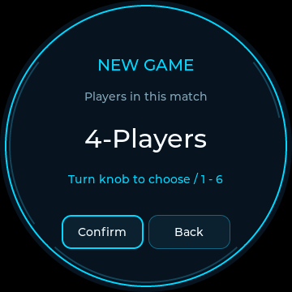
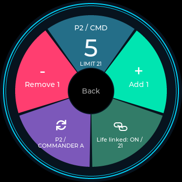

# Arcana / MTG Life Counter

A native Windows digital twin of a round 360 x 360 knob display, with a shared LVGL interface designed for eventual ESP32-S3 deployment. The app tracks **P1 (you)** and incoming commander damage from a pod of **1-6 players**, with saved-match recovery and a touch/rotary interface.



Arcana is a Commander-focused Magic: The Gathering life counter for a round touch display and rotary encoder. The desktop simulator runs the shared C++17/LVGL interface so the design and game logic can be tested before connecting ESP32-S3 hardware.

- Tap or hold the life halves, or turn the encoder, to adjust your life.
- Track incoming damage independently for each opponent commander, with optional linked life changes.
- Pick Treasure, Poison, Energy, Experience, Storm, Rad or Shield for either side shortcut without losing counts.
- Use radial menus for counters, commander damage, coin flips, starter rolls, brightness and game controls.
- Recover unfinished matches, undo recent changes, and see clear lethal-condition warnings.

The current implementation is a working Windows digital twin with portable game logic and hardware interfaces. Physical display, backlight, battery and encoder drivers still need board-specific integration.

| Startup | Player count | Main dial | Opponent damage |
| --- | --- | --- | --- |
|  |  |  |  |

## Build and run on Windows

Requires Git, CMake 3.24+ and a C++17 compiler. Install Visual Studio 2022 C++ Build Tools and CMake in PowerShell:

```powershell
winget install --id Git.Git -e
winget install --id Kitware.CMake -e
winget install --id Microsoft.VisualStudio.2022.BuildTools -e --override "--wait --passive --add Microsoft.VisualStudio.Workload.VCTools --includeRecommended"
```

Open a new terminal in this directory:

```bat
tools\build_simulator.bat
tools\run_tests.bat
tools\run_simulator.bat
```

CMake fetches pinned **LVGL 9.2.2** and **SDL 2.30.11** sources on first configuration, requiring GitHub access. SDL is statically linked: no DLL copying, Docker or WSL is needed. The scripts also recognize the workspace-local CMake 3.31.6 and LLVM-MinGW 20250305 used for local verification. Close any running simulator before rebuilding its executable.

## Start, continue, or finish a match

Startup offers **New game** and **Continue**. Continue is greyed out when there is no unfinished saved match, including after explicitly ending the last game.

1. Select **New game**. The center defaults to **4-Players**.
2. Turn clockwise to increase the count or counterclockwise to decrease it (1-6). **Confirm** is on the left; **Back** on the right returns to startup without replacing an existing match.
3. Confirm opens the main dial with only the opponent tabs P2 through Pn across the top. **P1 is always you**, on the main life face. A one-player game has no opponent tabs.
4. The main face edits your life with the rotary knob, mouse wheel or arrow keys, or by tapping the colored halves: red subtracts 1 and green adds 1. Hold either half for 5 life per one-second beat, starting after the first second. Release adds no extra tap; leaving the region, changing screens or powering off stops the hold. The outer +/- controls adjust only their selected token/counter.
5. Select **P2-Pn** to open that player's commander-damage panel. The knob and +/- edit damage immediately, independently for each commander. Close returns to P1. The small number below an opponent's tab is their highest individual commander-damage total **to you**, not their life total.
6. Under **Gear > End Game**, confirm **End game** to finish the match and disable Continue. Back cancels. Simply closing the application does **not** end the match.

**Continue restores the last unfinished match**, including all counters, names, sources, cast counts, statuses, settings and the available Undo/Redo history. Restart Device saves and reloads the session, then returns to startup.

## Main-face shortcuts and five-second Undo

The left shortcut defaults to Treasures; the right defaults to Poison. Each shows its own current count on the symbol. The curved +/- segments above and below each symbol edit that side's **selected tracker**, independently of life. Their outside edge follows the main-face circle, while their inside edge stops at the continuous teal life-dial ring beside the segmented ring. Plus is green and minus is pink; their symbols sit in the center of each visible curved field. Both token outlines match the main-face teal.

- **Tap** either shortcut or its number badge to open a seven-section radial picker. Choose Treasures, Poison, Energy, Experience, Storm, Rad or Shield; every section shows its current count and the selected type has a checkmark. No hold or scrolling is needed. The center Back returns without changing the selection. Choosing another type preserves every count; both sides can use the same tracker.
- Both shortcut choices and all counts are saved and restored with the match. New Game resets them to their defaults.
- Shield is a **manual tally** for the permanent(s) you are tracking, not a player counter or automated prevention effect. Storm counts spells manually; the app does not infer card triggers.

The main-face **Undo** reverses the entire group of game edits from the preceding **five seconds**, including linked life/commander damage and counter edits. Two five-step life reductions show **Undo -10**. A single-counter group shows its delta and name; mixed edits show an edit count. After five seconds with no eligible edits it becomes disabled. Normal Undo/Redo remains available under Trackers > History and through Ctrl+Z/Y. A recently undone group can be redone as one history entry. The quick group can include more than 64 rapid edits; after restarting, the saved advanced history is available, while the process-local five-second window starts fresh.

## Gear menu

The gear sits centrally between the two parts of the white life total, with a smooth red heart beneath it and no LIFE caption. The life title is omitted; the center divider is green above the gear and red below, matching the corresponding colored inner ring segments. It opens:

- **New Game:** asks Yes/No before clearing the current match, retaining its player count. No preserves the match. Startup's New game still offers the player-count selection.
- **Flip Coin:** shows a random Heads/Tails result, with Flip again and central Back.
- **End Game:** confirms whether to finish the match and disable Continue.
- **Roll:** rolls one D20 per player. The highest result starts; only tied high rollers reroll. The screen shows the winner and the final round's rolls, with Roll again and central Back. An exceptionally long unresolved tie offers another roll rather than choosing a biased winner.

**Brightness** opens a percentage/slider section and large minus/plus sectors. A central grey Back on black returns to the life face. The Trackers button has been removed from this menu; the simulator's Tab shortcut still opens advanced trackers. Random tools never change match stats or consume Undo history.

Poison uses the Phyrexian mark, and Energy, Rad and Shield use MTG glyphs sourced through the Mana font. Experience uses the Commander 2015 emblem. Treasure and Storm use original chest/cloud drawings; no unverified official-symbol claim is made. See [symbol sources and licenses](docs/symbols.md).

## Commander damage and counters

- **Linked damage:** Life linked ON deducts life once with each positive commander-damage adjustment. Record only is available when life is already adjusted or damage has special results such as infect. Poison and other consequences remain manual.
- **Corrections:** counterclockwise/minus reduces damage. Record-only damage is removed first, then linked damage is removed with a refund of life actually deducted. This never refunds unlinked life loss. Use **Undo** for an exact reversal of the most recent transaction.
- **Partners:** Trackers > Commander Damage > + Commander source adds an independent source for the selected owner's seat. In the radial opponent panel, tap the purple source section to cycle through that player's commanders. Source IDs remain separate even if renamed. A 21-damage warning is checked per source, not by adding partners together.
- **Detailed receipts:** the existing Commander Damage list also offers a draft amount and explicit Apply action, useful for recording one combat event with its linked life change atomically.
- **Poison:** use the side +/- controls when Poison is selected, or edit under Trackers. Default warning threshold 10; variants can change it under Deck Trackers.
- **Your Commanders:** maintain each commander's command-zone cast count. Next tax is twice that count, independently for partners and Backgrounds. Returning a commander to the command zone does not itself count as a cast.
- **Optional trackers:** enable energy, experience, rad, all players' spells this turn or one named custom counter under Deck Trackers. Hiding a tracker preserves its value. New turn resets the spells count only; all spell counting is manual.
- **Table Status:** independently record whether you are monarch, have initiative or have the city's blessing, plus the shared day/night marker. Card effects and dungeon progression remain manual.
- **Names:** turn to choose a character, Append, Delete, then Save. Back cancels. Maximum name length is 24 characters.
- **Undo/Redo:** the most recent 64 actions are retained. A new action after Undo discards the redo branch. Starting a new game clears the old history; ending a game cannot be undone to reactivate Continue.

Counters remain nonnegative; life supports signed 64-bit negative totals. Overflow is rejected atomically. Warnings do not lock the game or adjudicate card-specific exceptions. On lists the knob scrolls, without silently changing life.

## Saved games

The simulator stores versioned JSON at SDL's per-user preference path, normally:

```text
%APPDATA%\Arcana\MTGLifeCounter\current-game.json
```

Match creation and End Game save immediately. Counter changes are coalesced after 600 ms of inactivity; ordinary window close, power-off and restart flush pending changes. A forced termination can lose the last unsaved portion of a burst. Files are written through a temporary file and replaced atomically. An invalid or unsupported save disables recovery without partially loading its values. A visible save error is shown if saving fails; retries continue automatically.

To use an explicit location (including portable/workspace storage):

```bat
build\mtg_simulator.exe --save-file "D:\my-matches\current-game.json"
```

Schema 3 includes Shield and selected shortcuts; schema 1 and 2 saves migrate automatically without resetting existing stats.

The storage interface and serialization are shared/portable; the file adapter is desktop-specific. JSON support is vendored **nlohmann/json 3.11.3**, with its [MIT license](src/third_party/LICENSE-json.txt), so this adds no build-time download.

## Desktop controls

| Input | Action |
| --- | --- |
| Wheel / Up / Right | Increase the visible value; scroll lists |
| Wheel down / Down / Left | Decrease the visible value; scroll lists |
| Mouse | Touch buttons, hold, drag lists |
| Tab | Open Trackers |
| Ctrl+Z / Ctrl+Y | Undo / Redo |
| P | Simulated screen power |
| R | Ask to reset an active match; otherwise open player setup |
| Escape / window close | Exit |

The right panel provides encoder buttons, logical power, restart and new-game setup. Restart returns to startup and offers Continue for unfinished matches. Rotation while off is ignored. No physical battery behavior is simulated, and no unverified encoder push button is exposed.

## Tests and scope

`tools\run_tests.bat` runs five suites: core game rules, saved games/storage, touch-driven LVGL flows, an SDL simulator smoke test, and separate-process recovery. Tests cover startup/Continue, selection bounds, four/six-player tabs, independent opponent damage, linked/unlinked corrections, End Game, JSON validation, atomic replacement, save failure/retry, coalesced writes, source separation, tax, Undo/Redo and 100,000 rapid input steps. Tests also cover coin outcomes, D20 tie-breaking, reset confirmation, shortcut hold/tap behavior, retained counts, old-schema migration and rolling Undo windows. Screenshots are generated in `build/ui-*.bmp` and `build/simulator-*.bmp`.

The selected player count represents your Commander pod; **other players' life totals are not tracked in this layout**. A full shared-device Arena mode, physical hardware drivers and wireless synchronization remain future work. Desktop side panels are simulator controls; all device screens use shared LVGL code.

For core-only tests without graphical dependencies:

```powershell
cmake -S . -B build-core -DBUILD_SIMULATOR=OFF
cmake --build build-core --config Release
ctest --test-dir build-core -C Release --output-on-failure
```

See [architecture](docs/architecture.md), [hardware verification](docs/hardware.md), [counter rules](docs/counters.md), and [development](docs/development.md). The circular design takes inspiration from [Soul Dial](https://souldial.net/products/the-soul-dial%E2%84%A2); no product images, artwork or code are included. The generated numeric font derives from Montserrat under its [SIL Open Font License](src/assets/OFL-Montserrat.txt).

Life totals below ten display as 00?09, with units on the right. At zero life, lethal poison or 21 damage from one commander, a white skull replaces the heart and a white reason appears beneath it. These warnings do not end the match automatically and clear when corrected. Opponent player labels follow the circle; their entire colored wedges accept touch for every supported player count.

The horizontal battery indicator opposite the heart across the gear center uses the requested 0?5, 6?20, 21?40, 41?60, 61?80 and 81?100 percent bands, with a separate charging bolt. The simulator supplies an illustrative 75% reading; the hardware interface accepts real percentage/charging status, with an unknown marker until a hardware driver supplies a reading. No battery-saving behavior is enabled.

Settings uses five colored radial sections for New Game, Flip Coin, Roll, End Game and Brightness, with white icons and a grey Back button on a black center. Tool results return to settings; the central Back returns to the life face. Brightness supports 0?100% through touch slider, +/- and encoder; the desktop simulates it with display opacity. The physical driver must implement backlight control and its electrical minimum/maximum. Brightness is currently session-only. At 0%, use clockwise encoder input to raise it again.

All gear tool screens share the radial design with Back in the middle. New/End Game put their question above Back and confirmation/cancel sectors below. Coin puts its result above and reflip below. Roll gives each player a separate die-result section plus winner and reroll sections. Brightness puts its percentage/slider above and large minus/plus sections below. Back never rerolls, resets, confirms, or changes counters.

Main-face counter icons share the exact color of their type in the radial selector. Undo is a lower annular tile mirroring the player tiles, with a matching curved hit area and its existing timed label/disabled state.

Undo text follows the lower tile's curve, including its changing amount; disabled styling and the full curved hit area are preserved.

Menu navigation uses a 180 ms ease-out fade-in, updating at most every 33 ms. Outer frame rings stay opaque; life/counter edits remain immediate. It stops entirely when complete and cancels on power-off or a new screen build. No bitmap snapshots or continuous idle animation are used.

Opponent commander-damage screens use five radial sections: damage/limit at the top, Add 1 and Remove 1 at the sides, commander-source cycling and life-link mode below. Central Back returns to the main face to select another opponent. The encoder still edits the selected source directly, with existing linked-life correction behavior preserved.
