# Arcana / MTG Life Counter

**Version 0.14.0** - Windows digital twin, multi-format play and local-network multiplayer.

A native Windows digital twin of a round 360 x 360 knob display, with a shared LVGL interface designed for eventual ESP32-S3 deployment. The app supports Commander, Classic, Commander 2HG, Brawl and Limited, with saved-match recovery and a touch/rotary interface.


Arcana is a multi-format Magic: The Gathering life counter for a round touch display and rotary encoder. The desktop simulator runs the shared C++17/LVGL interface so the design and game logic can be tested before connecting ESP32-S3 hardware.

- Tap or hold the life halves, or turn the encoder, to adjust your life.
- Track incoming damage independently for each opponent commander, with optional linked life changes.
- Pick Treasure, Poison, Energy, Experience, Storm, Rad or Shield for either side shortcut without losing counts.
- Use radial menus for counters, commander damage, coin flips, starter rolls, brightness and game controls.
- Host or join a local-network Multi Arcana match with persistent player names and synchronized life.
- Recover unfinished matches, undo recent changes, and see clear lethal-condition warnings.

The current implementation is a working Windows digital twin with portable game logic and hardware interfaces. Physical ESP32 display, backlight, battery, encoder, storage and Wi-Fi drivers still need board-specific integration. The LAN implementation runs in the Windows simulator; firmware is not yet ready to flash.

| Startup | Player count | Main dial | Opponent damage |
| --- | --- | --- | --- |
|  |  |  |  |

## Build and run on Windows

Requires Git, CMake 3.24+ and a C++17 compiler. Install Visual Studio 2022 C++ Build Tools and CMake in PowerShell:

```powershell
winget install --id Git.Git -e
winget install --id Kitware.CMake -e
winget install --id Microsoft.VisualStudio.2022.BuildTools -e --override "--wait --passive --add Microsoft.VisualStudio.Workload.VCTools --includeRecommended"
```

Open a new terminal in this directory:

```bat
tools\build_simulator.bat
tools\run_tests.bat
tools\run_simulator.bat
```

CMake fetches pinned **LVGL 9.2.2** and **SDL 2.30.11** sources on first configuration, requiring GitHub access. SDL is statically linked: no DLL copying, Docker or WSL is needed. The scripts also recognize the workspace-local CMake 3.31.6 and LLVM-MinGW 20250305 used for local verification. Close any running simulator before rebuilding its executable.

## Start, continue, or finish a match

Startup offers **New game** and **Continue**. Continue is greyed out when there is no unfinished saved match, including after explicitly ending the last game.

1. Select **New game**, then **SINGLE ARCANA** for the regular format selector, or **MULTI ARCANA** for name entry and Host/Join. Only format titles appear in the format selector.
2. Confirm the player setup in its round menu. Commander defaults to four players and Classic to two; both allow 2-6. Brawl and Limited use two players. Commander 2HG defaults to two teams and allows 2-6 teams (4-12 players), with two players per team. Rotary or the side sections adjust configurable counts; central Back returns one step without replacing an existing match.
3. In Single Arcana, Confirm opens the main dial. **P1 is always you**. In 2HG, P1/P2 are your team; P3/P4, P5/P6 and successive pairs form the other teams. All enemy seats appear in the top tabs.
4. Tap the red/green life halves for -/+1, or hold for -/+5 per one-second beat. The encoder edits life immediately. Outer +/- controls adjust their selected counter.
5. In Single Arcana, opponent tabs show incoming commander damage in Commander/2HG and the opponent's life in Classic/Brawl/Limited. Their round screens edit the corresponding value; central Back returns to P1. New games restore every tracked life total to the selected preset.
6. Under **Gear > End Game**, confirm **End game** to finish the match and disable Continue. Back cancels. Simply closing the application does **not** end the match.

**Continue restores the last unfinished local match**, including counters, commander/source names, cast counts, statuses, match settings and available Undo/Redo history. Brightness and live network membership are session-only; the separate device-name profile persists independently. Restart Device saves and reloads the session, then returns to startup.

## Single and Multi Arcana

| Mode | Name entry | Host / Join |
| --- | --- | --- |
| 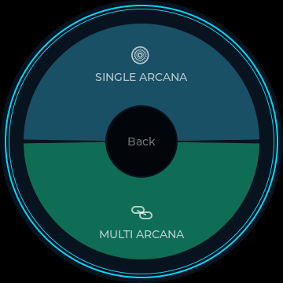 | 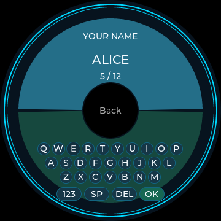 | 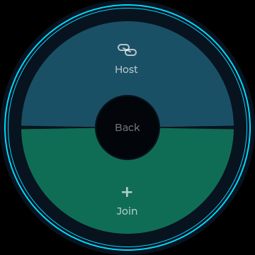 |

New game opens a horizontally divided radial screen: **SINGLE ARCANA** above, **MULTI ARCANA** below, with Back in the middle. Single continues to the existing format/player setup.

Multi opens name entry: the name appears above the central Back button and a compact QWERTY keyboard below it. `123` switches to digits/hyphen/underscore, `SP` adds a space, `DEL` deletes, and `OK` confirms. Names use 1-12 ASCII letters/digits/spaces/hyphen/underscore. The device profile stores both the name and a stable device ID independently from match saves, so new games and application shutdown never reset the name. Saving failure keeps the previous name.

| Discovered games | Joined lobby | Live named face |
| --- | --- | --- |
| 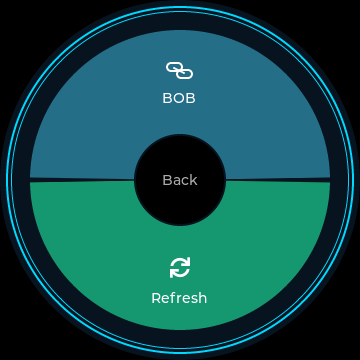 | 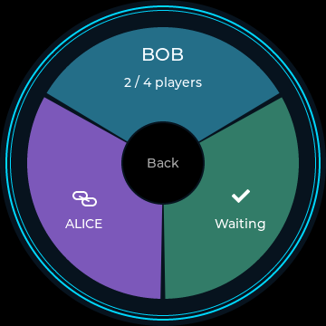 | 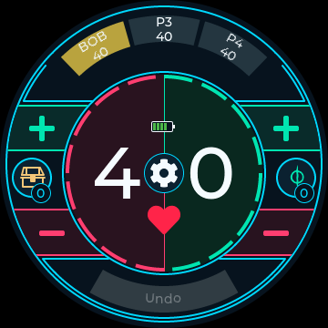 |

After confirming the name:

- **Host** chooses a format and player/team capacity, then creates a lobby named after the host. Start game works with a partially filled roster, including 2HG and even a single connected Arcana. The selected count reserves seats for people without devices or delayed players.
- **Late arrivals** can join after play has started. Every unclaimed seat stays visible as a dim P2-Pn tile; the host can track its life manually. Joining claims the next free seat, replaces its label with the registered name and inherits the tracked life/counters without resetting anyone else. In 2HG this includes the current shared team life and poison.
- **Join** discovers hosted games on the same LAN. Select a host's name to join, without a password. Discovery refreshes automatically and has Refresh/Next controls for multiple pages.
- Each device edits its own life and counters. Other players' registered names and life totals replace the P2-Pn tiles in Multi, including Commander. Tapping a remote tile opens a read-only life view; longer names may be shortened on narrow tiles and appear in full in that view.
- The host coordinates state. Edits have sequence numbers/acknowledgements and retries; duplicate packets never apply twice. Rapid edits coalesce without losing their total. 2HG teammates share life and poison; other counters remain individual. Commander-damage bookkeeping remains local to each device, with linked life changes synchronized.
- Host End Game closes the clients' matches. A guest End Game leaves only that guest. Local stats remain saved if communication fails. Heartbeats mark missing devices and joining again with the same profile reconnects the same participant while the host is still running.

| Open seat (host can track life) | Late join replaces the seat |
| --- | --- |
| 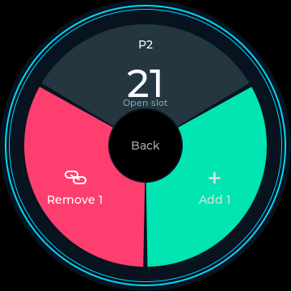 | 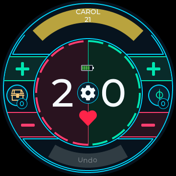 |

The Windows digital twin implements actual IPv4 LAN networking: multicast discovery uses UDP `239.255.42.88:42688`; gameplay uses each process's own UDP port. Instances must share a local network and the app must be allowed through its local firewall. No cloud service, account or internet connection is used. The passwordless protocol is intended for a trusted local network.

To try two independent devices on one computer, run two instances with separate saves/profiles:

```powershell
Start-Process .\build\mtg_simulator.exe -ArgumentList '--save-file build/host-session.json --profile-file build/host-profile.json'
Start-Process .\build\mtg_simulator.exe -ArgumentList '--save-file build/guest-session.json --profile-file build/guest-profile.json'
```

Choose different names, host on one, and join on the other. The default profile sits beside the default match save in the per-user Arcana directory. `--profile-file` overrides it; generated profile files are ignored by Git.

Names persist across process restarts. Live lobby membership, host state and unacknowledged network edits are process-local: after shutdown, use Multi/Join to reconnect to a still-running host. There is no host migration or automatic lobby restoration after the host process closes. Continue still restores the local saved match; reconnecting uses the running host's canonical state.

Physical ESP32 Wi-Fi/display/storage drivers remain separate work. For tabletop hardware, the proposed host-created Wi-Fi access point avoids needing a venue router; the simulator uses an existing LAN. [Waveshare confirms the board's Wi-Fi capability](https://www.waveshare.com/product/esp32-s3-knob-touch-lcd-1.8.htm). The portable multiplayer engine uses `IPeerTransport`, so an ESP32 Wi-Fi/UDP adapter can reuse the protocol; no on-device networking has been flashed or verified yet.

## Format presets

| Formats | Six-team setup | Six-team face |
| --- | --- | --- |
| 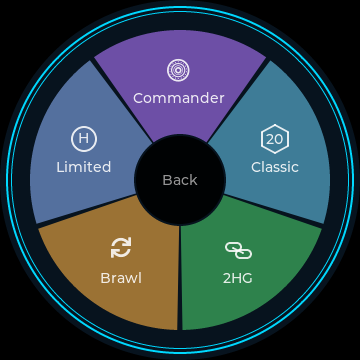 | 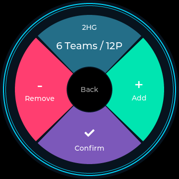 | 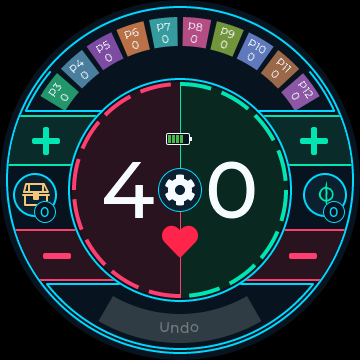 |

| Format | Default seats | Starting life | Opponent tabs |
| --- | --- | --- | --- |
| Commander | 4 (2-6) | 40 each | Incoming commander damage |
| Classic | 2 (2-6) | 20 each | Opponent life |
| 2HG | 2-6 teams, 4-12 players | 40 shared per team | Incoming commander damage |
| Brawl | 2 | 25 each | Opponent life |
| Limited | 2 | 20 each | Opponent life |

2HG is the requested **Commander variant with 40 team life**, not the ordinary 30-life 2HG preset. P1/P2 share life and a poison count (loss warning at 15); other modes use poison 10. In the 2HG commander panel, **To P1 / To P2** selects the damage recipient. Damage to the two teammates is never added together for the 21-damage warning; linked life changes affect their shared total. Every opposing team's shared life is modeled independently. Each setup step adds/removes one whole team: **2 Teams / 4P** through **6 Teams / 12P**. Starter rolls select **T1-T6** as appropriate. Optional Energy/Experience/etc. remain local-player counters.

Brawl uses the requested tabletop 25-life preset and has no commander-damage loss warning. See [Wizards' Brawl format page](https://magic.wizards.com/en/formats/brawl). No separate Arena preset is included.

## Main-face shortcuts and five-second Undo

The left shortcut defaults to Treasures; the right defaults to Poison. Each shows its own current count on the symbol. The curved +/- segments above and below each symbol edit that side's **selected tracker**, independently of life. Their outside edge follows the main-face circle, while their inside edge stops at the continuous teal life-dial ring beside the segmented ring. Plus is green and minus is pink; their symbols sit in the center of each visible curved field. Both token outlines match the main-face teal.

- **Tap** either shortcut or its number badge to open a seven-section radial picker. Choose Treasures, Poison, Energy, Experience, Storm, Rad or Shield; every section shows its current count and the selected type has a checkmark. No hold or scrolling is needed. The center Back returns without changing the selection. Choosing another type preserves every count; both sides can use the same tracker.
- Both shortcut choices and all counts are saved and restored with the match. New Game resets them to their defaults.
- Shield is a **manual tally** for the permanent(s) you are tracking, not a player counter or automated prevention effect. Storm counts spells manually; the app does not infer card triggers.

The main-face **Undo** reverses the entire group of game edits from the preceding **five seconds**, including linked life/commander damage and counter edits. Two five-step life reductions show **Undo -10**. A single-counter group shows its delta and name; mixed edits show an edit count. After five seconds with no eligible edits it becomes disabled. Normal Undo/Redo remains available under Trackers > History and through Ctrl+Z/Y. A recently undone group can be redone as one history entry. The quick group can include more than 64 rapid edits; after restarting, the saved advanced history is available, while the process-local five-second window starts fresh.

## Watch face and interaction

- Life totals use **00-09** for single digits, with units on the right of the central gear. Tap red/green for -/+1; hold for -/+5 per second. Release adds no extra tap.
- The red heart becomes a **white skull with a white reason** at zero life, lethal poison or lethal commander damage. Correcting the condition restores the heart. Warnings remain advisory and never automatically end a game.
- Opponent names/numbers follow the top arc and the **whole colored tile** accepts touch. Single shows Pn; Multi shows registered names and synchronized life. Single 2HG supports ten enemy-player tiles, P3-P12.
- The bottom **Undo tile and its text both follow the circle**, mirrored against the player tiles. Its curved hit area, timed amount and disabled state match the visible shape.
- The two side-counter icons match their type's background color in the selector. Their teal outlines and complete count badges remain consistent across types.
- All tool screens use colored radial sections, white icons and **grey Back on a black center**. Back returns one step without confirming, rolling or changing counters.
- Navigation uses a **180 ms ease-out fade**, with updates at most every 33 ms. Outer frame rings stay opaque. Life/counter edits are instant, and animation stops completely when finished or powered off.

### Battery and brightness

The horizontal battery icon sits opposite the heart across the gear center. It displays six bands: **0-5%, 6-20%, 21-40%, 41-60%, 61-80%, 81-100%**, plus charging and unknown states. The simulator uses an illustrative 75% reading; a hardware adapter must provide real telemetry. Battery-saving behavior and battery-runtime estimates are not implemented.

**Brightness** is adjustable from **0-100%** by slider, +/- sectors or rotary input. The desktop previews it using display opacity; physical backlight control needs the hardware driver. Brightness is session-only. If set to 0%, clockwise encoder input raises it again.

## Gear menu

The gear sits centrally between the two parts of the white life total, with a smooth red heart beneath it and no LIFE caption. The life title is omitted; the center divider is green above the gear and red below, matching the corresponding colored inner ring segments. It opens:

- **New Game:** asks Yes/No, then opens Single/Multi selection and the chosen setup flow. The current match is replaced only on Confirm; cancelling preserves it.
- **Flip Coin:** shows a random Heads/Tails result, with Flip again and central Back.
- **End Game:** confirms whether to finish the match and disable Continue.
- **Roll:** rolls one D20 per player, or per team in 2HG. The highest result starts; only tied high rollers reroll. The screen shows the winner and the final round's rolls, with Roll again and central Back. An exceptionally long unresolved tie offers another roll rather than choosing a biased winner.

**Brightness** opens a percentage/slider section and large minus/plus sectors. A central grey Back on black returns to the life face. The Trackers button has been removed from this menu; the simulator's Tab shortcut still opens advanced trackers. Random tools never change match stats or consume Undo history.

Poison uses the Phyrexian mark, and Energy, Rad and Shield use MTG glyphs sourced through the Mana font. Experience uses the Commander 2015 emblem. Treasure and Storm use original chest/cloud drawings; no unverified official-symbol claim is made. See [symbol sources and licenses](docs/symbols.md).

## Commander damage and counters

- **Linked damage:** Life linked ON deducts life once with each positive commander-damage adjustment. Record only is available when life is already adjusted or damage has special results such as infect. Poison and other consequences remain manual.
- **Corrections:** counterclockwise/minus reduces damage. Record-only damage is removed first, then linked damage is removed with a refund of life actually deducted. This never refunds unlinked life loss. Use **Undo** for an exact reversal of the most recent transaction.
- **Partners:** Trackers > Commander Damage > + Commander source adds an independent source for the selected owner's seat. In the radial opponent panel, tap the purple source section to cycle through that player's commanders. Source IDs remain separate even if renamed. A 21-damage warning is checked per source, not by adding partners together.
- **Detailed receipts:** the existing Commander Damage list also offers a draft amount and explicit Apply action, useful for recording one combat event with its linked life change atomically.
- **Poison:** use the side +/- controls when Poison is selected, or edit under Trackers. Default warning threshold 10; variants can change it under Deck Trackers.
- **Your Commanders:** maintain each commander's command-zone cast count. Next tax is twice that count, independently for partners and Backgrounds. Returning a commander to the command zone does not itself count as a cast.
- **Optional trackers:** enable energy, experience, rad, all players' spells this turn or one named custom counter under Deck Trackers. Hiding a tracker preserves its value. New turn resets the spells count only; all spell counting is manual.
- **Table Status:** independently record whether you are monarch, have initiative or have the city's blessing, plus the shared day/night marker. Card effects and dungeon progression remain manual.
- **Commander/custom-counter names:** turn to choose a character, Append, Delete, then Save. Back cancels. Maximum length is 24 characters. The independent multiplayer device name uses the keyboard and a 12-character limit.
- **Undo/Redo:** the most recent 64 actions are retained. A new action after Undo discards the redo branch. Starting a new game clears the old history; ending a game cannot be undone to reactivate Continue.

Counters remain nonnegative; life supports signed 64-bit negative totals. Overflow is rejected atomically. Warnings do not lock the game or adjudicate card-specific exceptions. On lists the knob scrolls, without silently changing life.

## Saved games

The simulator stores versioned JSON at SDL's per-user preference path, normally:

```text
%APPDATA%\Arcana\MTGLifeCounter\current-game.json
```

Match creation and End Game save immediately. Counter changes are coalesced after 600 ms of inactivity; ordinary window close, power-off and restart flush pending changes. A forced termination can lose the last unsaved portion of a burst. Files are written through a temporary file and replaced atomically. An invalid or unsupported save disables recovery without partially loading its values. A visible save error is shown if saving fails; retries continue automatically.

To use an explicit location (including portable/workspace storage):

```bat
build\mtg_simulator.exe --save-file "D:\my-matches\current-game.json"
```

Schema 5 stores up to twelve seats, the selected format, opponent life, team assignments and commander-damage recipients. Schema 4 saves retain their format and team totals; schemas 1-3 migrate as Commander games without resetting existing local stats or history.

The storage interface and serialization are shared/portable; the file adapter is desktop-specific. JSON support is vendored **nlohmann/json 3.11.3**, with its [MIT license](src/third_party/LICENSE-json.txt), so this adds no build-time download.

## Desktop controls

| Input | Action |
| --- | --- |
| Wheel / Up / Right | Increase the visible value; scroll lists |
| Wheel down / Down / Left | Decrease the visible value; scroll lists |
| Mouse | Touch buttons, hold, drag lists |
| Tab | Open Trackers |
| Ctrl+Z / Ctrl+Y | Undo / Redo |
| P | Simulated screen power |
| R | Confirm a new game if active; otherwise open Single/Multi selection |
| Escape / window close | Exit |

The right panel provides encoder buttons, logical power, restart and new-game setup. Restart returns to startup and offers Continue for unfinished matches. Rotation while off is ignored. No physical battery behavior is simulated, and no unverified encoder push button is exposed.

## Tests and scope

`tools\run_tests.bat` runs eight suites: game rules, storage, multiplayer protocol/profile behavior, real UDP discovery/sync, separate host/client processes, round-screen UI, SDL smoke and process recovery. Coverage includes all five formats; 2-6 teams and all twelve seats; startup/Continue and cancelled setup; independent opponent life and commander damage; linked-life corrections; poison thresholds; retained counters; save migrations; atomic storage and retry; bounded Undo/Redo and five-second groups; battery bands; curved touch targets; fade timing; persistent device identities; keyboard/host/join flows; duplicate and lost packets; rapid-edit coalescing; simultaneous teammate edits; and host/client discovery between separate processes. Screenshots are generated in `build/ui-*.bmp` and `build/simulator-*.bmp`.

Commander tabs track incoming damage. Classic, Brawl and Limited tabs track opponents' life. Commander 2HG shares life and poison within your team while keeping incoming commander damage separate by recipient. Physical hardware drivers remain future work; desktop LAN synchronization is implemented. Desktop side panels are simulator controls; all device screens use shared LVGL code.

For core-only tests without graphical dependencies:

```powershell
cmake -S . -B build-core -DBUILD_SIMULATOR=OFF
cmake --build build-core --config Release
ctest --test-dir build-core -C Release --output-on-failure
```

See [architecture](docs/architecture.md), [hardware verification](docs/hardware.md), [counter rules](docs/counters.md), and [development](docs/development.md). The circular design takes inspiration from [Soul Dial](https://souldial.net/products/the-soul-dial%E2%84%A2); no product images, artwork or code are included. The generated numeric font derives from Montserrat under its [SIL Open Font License](src/assets/OFL-Montserrat.txt).
