# Arcana / MTG Life Counter

**Version 0.17.2** - About now links to the Nova Dynamics homepage with a scannable website QR code. Includes the v0.17.1 wake-protection fix, configurable idle display and experimental Bluetooth LE multiplayer.

Install [v0.17.2](https://github.com/michaelDengl/arcana-mtg-life-counter/releases/tag/v0.17.2) from the knob's **Update** button after checking for updates over Wi-Fi. Bluetooth remains experimental. Wi-Fi remains selectable for multiplayer and firmware updates.

A native Windows digital twin of a round 360 x 360 knob display, with the same LVGL interface running on the ESP32-S3 knob. The app supports Commander, Classic, Commander 2HG, Brawl and Limited, with in-memory matches and a touch/rotary interface.

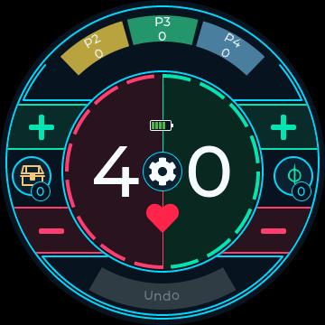

Arcana is a multi-format Magic: The Gathering life counter for a round touch display and rotary encoder. The desktop simulator runs the shared C++17/LVGL interface so the design and game logic can be tested before connecting ESP32-S3 hardware.

- Tap or hold the life halves, or turn the encoder, to adjust your life.
- Track incoming damage independently for each opponent commander, with optional linked life changes.
- Pick Treasure, Poison, Energy, Experience, Storm, Rad or Shield for either side shortcut without losing counts.
- Use radial menus for counters, commander damage, coin flips, starter rolls, brightness and game controls.
- Host or join a local-network Multi Arcana match with persistent player names and synchronized life.
- Undo recent changes and see clear lethal-condition warnings.

The Windows digital twin shares its game logic and LVGL interface with a **Guition JC3636K718 ESP32-S3 firmware build**, installed and boot-tested on physical units. The adapter covers the display, buffered touch input, corrected rotary input, backlight, persistent device names, voltage-based battery estimation, a dim battery-status RGB ring and direct device-to-device Wi-Fi. Reliable charging/full detection, audio and haptics remain unimplemented. See the [firmware build and backup-first installation guide](firmware/README.md) and [hardware verification notes](docs/hardware.md).

| Startup | Player count | Main dial | Opponent damage |
| --- | --- | --- | --- |
| 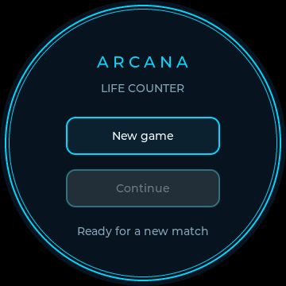 | 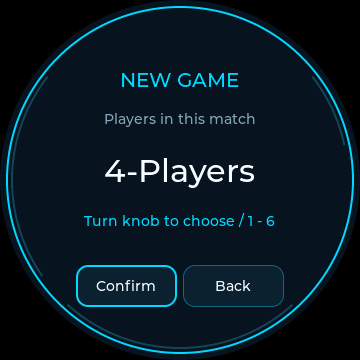 |  | 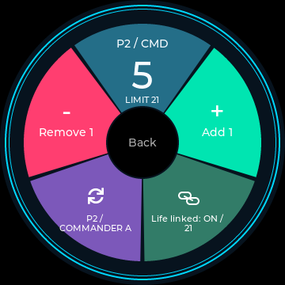 |

## Idle display and connection settings

Open **Gear > Display**. All five choices are saved independently of your match:

| Setting | Default | Behaviour |
| --- | --- | --- |
| Brightness | Existing saved level | Normal display brightness, 0?100%. |
| Dim After | 5 seconds | Encoder or +/- selects 1?300 seconds; 0 means Never. |
| Life Only | OFF | On the own-life face, idle hides the artwork and shows only a centred life total on black, on all twelve faces. |
| Wake Protection | OFF | OFF: the first touch or wheel turn wakes and acts immediately. ON: the first tap/initial wheel burst only wakes. Works even below 10% manual brightness. |
| Idle Brightness | 10% | Idle backlight level, capped at the selected normal brightness. |

A held wake touch with protection OFF keeps the usual five-life-per-second repeat. Incoming multiplayer life updates continue while Life Only is visible. Other menus keep their normal artwork while dimmed. Never disables both automatic dimming and the idle face. Black artwork on this IPS panel is primarily a visual feature; battery savings have not been measured.

For multiplayer, choose **Multi ARCANA > name > Connection** before Host/Join. **Bluetooth** is the experimental default. **Wi-Fi** keeps the existing access-point transport and works with the previously installed Wi-Fi firmware. All participants must use the same connection mode. Changing the connection leaves the existing match untouched and is available before hosting/joining; live matches never migrate radios automatically. The digital twin uses its existing IPv4 LAN for either selection and does not emulate the physical BLE radio.

BLE supports up to nine connected guests plus the host; additional game seats can still be tracked manually. Wi-Fi retains its previous limits. Internet setup and GitHub firmware updates always use Wi-Fi. See [implementation and validation notes](docs/ble-display-candidate.md).

## Watch faces and saved display settings

Open **Gear > Watch Face** during a match. Browse the three radial pages using **Next** and **Previous**, then tap a design to apply it. A check mark identifies the current choice; **Back** returns to settings. Selection preserves life, counters, Undo history and multiplayer state, and remains selected after restart and new games.

The twelve designs are **Original**, **Azure Comet**, **Copper Petal**, **Neon Circuit**, **Citrus Relay**, **Sunset Meridian**, **Verdant**, **Prism**, **Obsidian**, **Magenta Ledger**, **Ember Forge** and **Mana Confluence**. Original and Ember Forge retain their approved appearance. The other layouts use distinct arrangements; Neon Circuit, Verdant, Prism and Obsidian keep their approved palettes. Citrus Relay has top + / bottom - life regions; the other faces use left - / right +. All include opponent controls, both counter shortcuts, settings, recent Undo, battery and lethal warnings.


Mana Confluence keeps all life, counter, multiplayer, Undo, battery and lethal-warning controls. It appears on the existing third selector page and is remembered after restart. Its five-mana artwork is static; it does not animate while idle.


**Gear > Display > Brightness** now remembers the selected level after restart. It saves once adjustments have settled for 750 ms, or immediately when leaving the screen. Automatic idle dimming still restores the user's selected level and does not overwrite it. Existing profiles retain their name/identity and start with Original; devices without a saved brightness retain their hardware default. At a saved **0%**, a clockwise turn restores **10%** without changing life.

The Windows Face Studio runs these same firmware renderers. Use the left selector or **[ / ]** to compare designs without resetting the demo match. Run `tools\run_simulator.bat` to open it.

## Latest UI updates

- Firmware **v0.17.1** fixes wheel clicks escaping Wake Protection while the full face redraws after Life Only. Queued input is classified using physical sampling times; a fresh gesture after a pause still works immediately. Regression tests cover protected taps, held touches, delayed wheel batches and net-zero motion on all twelve faces.
- Firmware **v0.17.0** adds saved **Display** settings (Life Only OFF, Wake Protection OFF, five-second dim delay by default) and experimental **Bluetooth / Wi-Fi** multiplayer selection. Use **Connection > Wi-Fi** with earlier firmware. Bluetooth radio operation and battery savings still need a two-knob hardware test.
- Firmware **v0.16.3** adds **Mana Confluence**, a five-mana-colour design with licensed mana glyphs, bronze trim, ivory life digits and a stained-glass centre. All previous faces remain visually unchanged.
- Firmware **v0.16.2** introduced the six-section gear menu, paged Watch Face selector and persistent display settings. Existing OTA-enabled devices can install it from the startup **Update** button.
- The name keyboard uses gentle curved rows. Green **OK** is above the name; **CHANGE** is an inset bottom button, and **Back** remains alone in the center.
- **123/ABC** and **DEL** are positioned above the keys beside Back. CHANGE affects only the draft until OK confirms it.
- The Multi Arcana main face shows your saved name. Original and Ember Forge keep the **heart/skull above the gear** and the **battery below it**; the other designs place these indicators to suit their layout.
- Match saving and Continue have been removed. The fade uses a single background-opacity cover, and curved Undo letters are reused between updates.
- The watch-face, multiplayer and keyboard screenshots reflect these layouts. Hardware checks include interrupted flash-save recovery and idle-dimming/wake-gesture tests; eleven native suites and eleven host-tool tests pass. The firmware also supports on-demand 30-second performance captures over USB.

## Build and run on Windows

Requires Git, CMake 3.24+ and a C++17 compiler. Install Visual Studio 2022 C++ Build Tools and CMake in PowerShell:

```powershell
winget install --id Git.Git -e
winget install --id Kitware.CMake -e
winget install --id Microsoft.VisualStudio.2022.BuildTools -e --override "--wait --passive --add Microsoft.VisualStudio.Workload.VCTools --includeRecommended"
```

Open a new terminal in this directory:

```bat
tools\build_simulator.bat
tools\run_tests.bat
tools\run_simulator.bat
```

CMake fetches pinned **LVGL 9.2.2** and **SDL 2.30.11** sources on first configuration, requiring GitHub access. SDL is statically linked: no DLL copying, Docker or WSL is needed. The scripts also recognize the workspace-local CMake 3.31.6 and LLVM-MinGW 20250305 used for local verification. Close any running simulator before rebuilding its executable.

## Start or finish a match

Startup offers **New Game**, **Update** and **About**. Matches run entirely in memory; there is no Continue or automatic match saving.

1. Select **New Game**, then **SINGLE ARCANA** for the regular format selector, or **MULTI ARCANA** for name entry and Host/Join. Only format titles appear in the format selector.
2. Confirm the player setup in its round menu. Commander defaults to four players and Classic to two; both allow 2-6. Brawl and Limited use two players. Commander 2HG defaults to two teams and allows 2-6 teams (4-12 players), with two players per team. Rotary or the side sections adjust configurable counts; central Back returns one step without replacing an existing match.
3. In Single Arcana, Confirm opens the main dial. **P1 is always you**. In 2HG, P1/P2 are your team; P3/P4, P5/P6 and successive pairs form the other teams. All enemy seats appear in the top tabs.
4. Tap the red/green life halves for -/+1, or hold for -/+5 per one-second beat. The encoder edits life immediately. Outer +/- controls adjust their selected counter.
5. In Single Arcana, opponent tabs show incoming commander damage in Commander/2HG and the opponent's life in Classic/Brawl/Limited. Their round screens edit the corresponding value; central Back returns to P1. New games restore every tracked life total to the selected preset.
6. Under **Gear > End Game**, confirm **End game** to finish the match and return to startup. Back cancels. Restarting or closing the application discards the current match.

Life, counters, Undo/Redo history and live network membership are session-only. Restart Device starts a fresh session at startup. Your multiplayer device name, stable identity, watch face, display settings and selected connection remain saved independently.

## Device updates and About

Startup offers **New Game**, **Update** and **About**. Update is enabled only after ARCANA finds a newer stable GitHub Release containing the compatible device firmware. It checks once at startup when home Wi-Fi is configured; starting a game stops update networking. Manual checks and Wi-Fi setup are under About > Wi-Fi & Updates.

About shows the installed version, **https://nova-dynamics.ch**, and **MagicTG Kreuzlingen**. Tap the website to display a QR code that opens the Nova Dynamics homepage, or tap the group button for the supplied MagicTG Kreuzlingen WhatsApp invitation.

Wi-Fi setup displays a scannable code containing the temporary ARCANA network name and password. Scan it with your phone, accept Join, then follow the Wi-Fi sign-in page or notification to enter your home 2.4 GHz Wi-Fi details. If the page does not appear, open **http://192.168.4.1**. Setup closes on Back or after three minutes; it does not run during games. [Wi-Fi setup preview](docs/previews/ui-wifi-setup.png).

The display perimeter outside the face is forced to pure black, including during partial redraws and menu transitions. Firmware clears the full 360 x 360 LCD before enabling the backlight so stale pixels cannot remain around the circular face. This uses the existing transfer buffer rather than adding another LVGL masking layer.

| About and contact | Nova Dynamics website | MagicTG Kreuzlingen invite | Firmware updates |
| --- | --- | --- | --- |
| 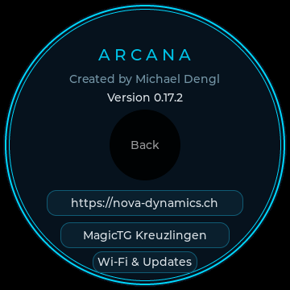 | 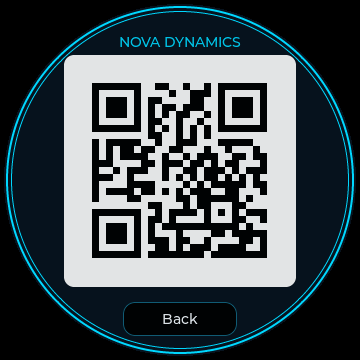 |  |  |


Wireless installation requires a one-time USB upgrade to the two-slot firmware layout. Your device name/profile storage stays at the same flash address. See the [wireless update setup and release guide](firmware/OTA.md). The owner's device successfully downloaded v0.15.1 from GitHub over Wi-Fi, booted from the second slot, confirmed its boot health and reported the installed release as current. The v0.15.2 QR/captive-portal phone flow still needs a physical phone check.

## Single and Multi Arcana

| Mode | Name entry | Host / Join |
| --- | --- | --- |
| 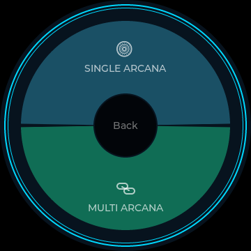 | 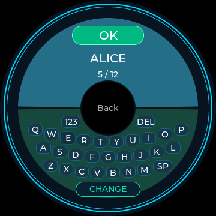 | 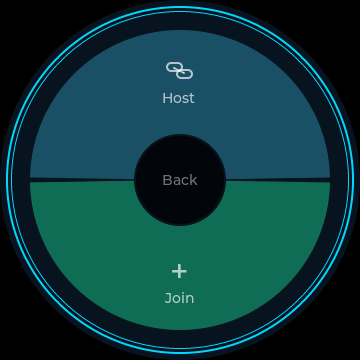 |

New game opens a horizontally divided radial screen: **SINGLE ARCANA** above, **MULTI ARCANA** below, with Back in the middle. Single continues to the existing format/player setup.

Multi opens name entry: the name appears above the central Back button and a compact QWERTY keyboard curved around it. Three shallow curved rows keep the letters upright and closer to a standard keyboard. A prominent green **OK button above the name** confirms it. Back stays alone in the black central circle. **CHANGE** sits in an inset bottom button below the keyboard; it clears the draft without overwriting the saved name until OK is pressed. The `123`/`ABC` toggle and `DEL` sit in the gaps above the keys, on either side of Back. `123` switches to digits/hyphen/underscore, `SP` adds a space, `DEL` deletes, and `OK` confirms. Names use 1-12 ASCII letters/digits/spaces/hyphen/underscore. The device profile stores both the name and a stable device ID independently from the in-memory match, so new games and application shutdown never reset the name. Saving failure keeps the previous name.

| Discovered games | Joined lobby | Live named face |
| --- | --- | --- |
| 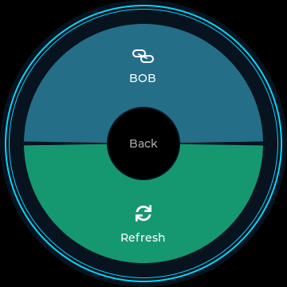 | 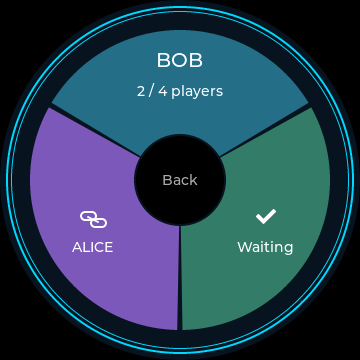 | 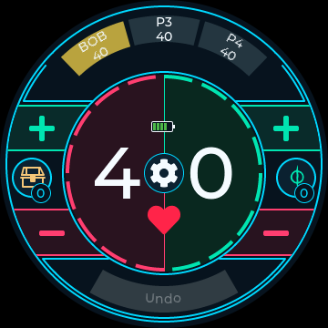 |

After confirming the name:

- **Host** chooses a format and player/team capacity, then creates a lobby named after the host. Start game works with a partially filled roster, including 2HG and even a single connected Arcana. The selected count reserves seats for people without devices or delayed players.
- **Late arrivals** can join after play has started. Every unclaimed seat stays visible as a dim P2-Pn tile; the host can track its life manually. Joining claims the next free seat, replaces its label with the registered name and inherits the tracked life/counters without resetting anyone else. In 2HG this includes the current shared team life and poison.
- **Join** discovers hosted games on the same LAN. Select a host's name to join, without a password. Discovery refreshes automatically and has Refresh/Next controls for multiple pages.
- Each device edits its own life and counters. Other players' registered names and life totals replace the P2-Pn tiles in Multi, including Commander. Tapping a remote tile opens a read-only life view; longer names may be shortened on narrow tiles and appear in full in that view.
- The host coordinates state. Edits have sequence numbers/acknowledgements and retries; duplicate packets never apply twice. Rapid edits coalesce without losing their total. 2HG teammates share life and poison; other counters remain individual. Commander-damage bookkeeping remains local to each device, with linked life changes synchronized.
- Host End Game closes the clients' matches. A guest End Game leaves only that guest. Local stats remain in memory if communication fails. Heartbeats mark missing devices and joining again with the same profile reconnects the same participant while the host is still running.

| Open seat (host can track life) | Late join replaces the seat |
| --- | --- |
| 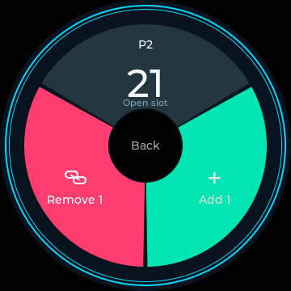 | 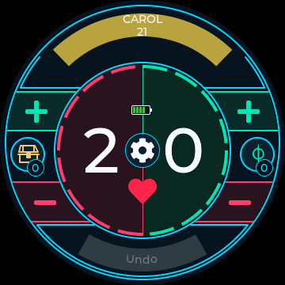 |

The Windows digital twin implements actual IPv4 LAN networking: multicast discovery uses UDP `239.255.42.88:42688`; gameplay uses each process's own UDP port. Instances must share a local network and the app must be allowed through its local firewall. No cloud service, account or internet connection is used. The passwordless protocol is intended for a trusted local network.

To try two independent devices on one computer, run two instances with separate profiles:

```powershell
Start-Process .\build\mtg_simulator.exe -ArgumentList '--profile-file build/host-profile.json'
Start-Process .\build\mtg_simulator.exe -ArgumentList '--profile-file build/guest-profile.json'
```

Choose different names, host on one, and join on the other. The default profile stays in the per-user Arcana directory. `--profile-file` overrides it; generated profile files are ignored by Git.

Names persist across process restarts. Live lobby membership, host state and unacknowledged network edits are process-local: after shutdown, use Multi/Join to reconnect to a still-running host. There is no host migration or automatic lobby restoration after the host process closes. Reconnecting uses the running host's canonical state.

On the Guition devices, choose **Multi ARCANA**, confirm your name, select **Connection > Wi-Fi**, then **Host** or **Join**. The Wi-Fi host creates an open 2.4 GHz ARCANA network after format/player confirmation. Join scans nearby ARCANA networks and lists their host names; tapping one connects and joins its game. No router, password or internet connection is required. Starting with empty seats and joining later use the same roster synchronization as the simulator. Back cancels a scan/join; ending or leaving the session turns off Wi-Fi. Single ARCANA keeps the radio off. All participating devices need this firmware update. The simulator continues to use the computer's existing LAN; see [firmware networking](firmware/README.md#multiplayer-and-remaining-hardware-work) for verification status and limits.

The user completed a successful five-device multiplayer playtest on 2026-11-21, reporting about four hours of battery runtime. An owner-device power candidate adds CPU scaling, event-driven idle input, automatic light sleep and reduced idle network traffic while preserving the existing display/ring settings. See [power management and testing](firmware/README.md#idle-power-management-power-v1) and [battery-gauge findings](firmware/README.md#battery-sensing-investigation-2026-11-22). Single ARCANA light sleep and wake/input behavior are verified on the owner device. Battery-runtime improvement and cross-device sleep compatibility still need physical validation.

## Format presets

| Formats | Six-team setup | Six-team face |
| --- | --- | --- |
| 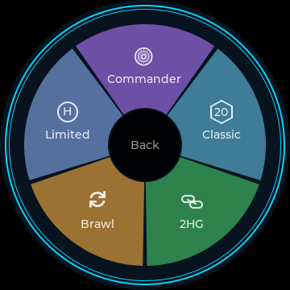 | 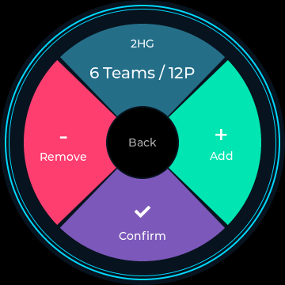 | 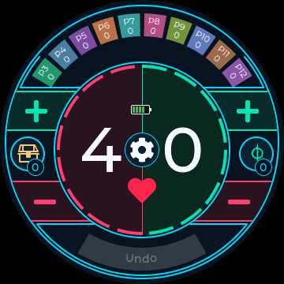 |

| Format | Default seats | Starting life | Opponent tabs |
| --- | --- | --- | --- |
| Commander | 4 (2-6) | 40 each | Incoming commander damage |
| Classic | 2 (2-6) | 20 each | Opponent life |
| 2HG | 2-6 teams, 4-12 players | 40 shared per team | Incoming commander damage |
| Brawl | 2 | 25 each | Opponent life |
| Limited | 2 | 20 each | Opponent life |

2HG is the requested **Commander variant with 40 team life**, not the ordinary 30-life 2HG preset. P1/P2 share life and a poison count (loss warning at 15); other modes use poison 10. In the 2HG commander panel, **To P1 / To P2** selects the damage recipient. Damage to the two teammates is never added together for the 21-damage warning; linked life changes affect their shared total. Every opposing team's shared life is modeled independently. Each setup step adds/removes one whole team: **2 Teams / 4P** through **6 Teams / 12P**. Starter rolls select **T1-T6** as appropriate. Optional Energy/Experience/etc. remain local-player counters.

Brawl uses the requested tabletop 25-life preset and has no commander-damage loss warning. See [Wizards' Brawl format page](https://magic.wizards.com/en/formats/brawl). No separate Arena preset is included.

## Main-face shortcuts and five-second Undo

The left shortcut defaults to Treasures; the right defaults to Poison. Each shows its own current count on the symbol. The curved +/- segments above and below each symbol edit that side's **selected tracker**, independently of life. Their outside edge follows the main-face circle, while their inside edge stops at the continuous teal life-dial ring beside the segmented ring. Plus is green and minus is pink; their symbols sit in the center of each visible curved field. Both token outlines match the main-face teal.

- **Tap** either shortcut or its number badge to open a seven-section radial picker. Choose Treasures, Poison, Energy, Experience, Storm, Rad or Shield; every section shows its current count and the selected type has a checkmark. No hold or scrolling is needed. The center Back returns without changing the selection. Choosing another type preserves every count; both sides can use the same tracker.
- Both shortcut choices and all counts stay in memory for the current match. New Game resets them to their defaults.
- Shield is a **manual tally** for the permanent(s) you are tracking, not a player counter or automated prevention effect. Storm counts spells manually; the app does not infer card triggers.

The main-face **Undo** reverses the entire group of game edits from the preceding **five seconds**, including linked life/commander damage and counter edits. Two five-step life reductions show **Undo -10**. A single-counter group shows its delta and name; mixed edits show an edit count. After five seconds with no eligible edits it becomes disabled. Normal Undo/Redo remains available under Trackers > History and through Ctrl+Z/Y. A recently undone group can be redone as one history entry. The quick group can include more than 64 rapid edits; restarting clears both advanced history and the five-second window.

## Watch face and interaction

- Life totals use **00-09** for single digits, with units on the right of the central gear. Tap red/green for -/+1; hold for -/+5 per second. Release adds no extra tap.
- The red heart becomes a **white skull with a white reason** at zero life, lethal poison or lethal commander damage. Correcting the condition restores the heart. Warnings remain advisory and never automatically end a game.
- Opponent names/numbers follow the top arc and the **whole colored tile** accepts touch. Single shows Pn; Multi shows registered names and synchronized life. Single 2HG supports ten enemy-player tiles, P3-P12.
- The bottom **Undo tile and its text both follow the circle**, mirrored against the player tiles. Its curved hit area, timed amount and disabled state match the visible shape.
- The two side-counter icons match their type's background color in the selector. Their teal outlines and complete count badges remain consistent across types.
- All tool screens use colored radial sections, white icons and **grey Back on a black center**. Back returns one step without confirming, rolling or changing counters.
- Navigation uses a **180 ms ease-out fade**, with updates at most every 33 ms through one fading cover rather than per-widget alpha layers. Outer frame rings stay opaque. Life/counter edits are instant, and animation stops completely when finished or powered off.

### Battery and brightness

In Original and Ember Forge, the horizontal battery icon sits below the gear, mirrored against the heart above it; other watch faces arrange these indicators to suit their layout. Multi also displays your saved name above the upper heart/skull. The battery displays six bands: **0-5%, 6-20%, 21-40%, 41-60%, 61-80%, 81-100%**, plus charging and unknown states. The simulator uses an illustrative 75% reading; a hardware adapter must provide real telemetry. The default idle policy dims to at most 10% after five seconds and restores the selected brightness on wake. Wake Protection defaults OFF; enable it to consume the wake tap or initial wheel burst. Low manual brightness still observes idle/wake settings without becoming brighter. Dim After and Idle Brightness are configurable; battery-runtime improvement has not been measured.

The physical RGB ring receives a uniform frame covering up to 64 LEDs, including longer ring revisions: **green at 30% battery or above, red below 30%**. Green uses 5/255 channel drive (about 2%); red uses 5/255 (about 2%). Extra pixel data is ignored by shorter chains. It stays off while USB power or an unavailable reading prevents a reliable battery estimate. The ring follows the same approximate battery estimate as the screen. It has no animation, updates only when the selected colour changes, and is independent of screen brightness. The extra battery consumption has not been measured.

**Brightness** is adjustable from **0-100%** by slider, +/- sectors or rotary input. The desktop previews it using display opacity; the Guition adapter drives real backlight PWM. Brightness is saved after adjustments settle or when leaving its screen. At 0%, turn clockwise to raise it; outside the brightness screen the first clockwise gesture restores 10% without editing life.

## Gear menu

In Original, the gear sits centrally between the two parts of the white life total, with the red heart above it, the battery below it and no LIFE caption. The life title is omitted; the center divider is green above the gear and red below, matching the corresponding colored inner ring segments. The six-section radial menu opens:

- **Watch Face:** browse all eleven designs across three radial pages, with the selected face marked and saved for restart.
- **Brightness:** adjust and save the display level from 0-100%.
- **New Game:** asks Yes/No, then opens Single/Multi selection and the chosen setup flow. The current match is replaced only on Confirm; cancelling preserves it.
- **Flip Coin:** shows a random Heads/Tails result, with Flip again and central Back.
- **End Game:** confirms whether to finish the match and return to startup.
- **Roll:** rolls one D20 per player, or per team in 2HG. The highest result starts; only tied high rollers reroll. The screen shows the winner and the final round's rolls, with Roll again and central Back. An exceptionally long unresolved tie offers another roll rather than choosing a biased winner.

**Brightness** opens a percentage/slider section and large minus/plus sectors. A central grey Back on black returns one step to settings. The Trackers button has been removed from this menu; the simulator's Tab shortcut still opens advanced trackers. Random tools never change match stats or consume Undo history.

Poison uses the Phyrexian mark, and Energy, Rad and Shield use MTG glyphs sourced through the Mana font. Experience uses the Commander 2015 emblem. Treasure and Storm use original chest/cloud drawings; no unverified official-symbol claim is made. See [symbol sources and licenses](docs/symbols.md).

## Commander damage and counters

- **Linked damage:** Life linked ON deducts life once with each positive commander-damage adjustment. Record only is available when life is already adjusted or damage has special results such as infect. Poison and other consequences remain manual.
- **Corrections:** counterclockwise/minus reduces damage. Record-only damage is removed first, then linked damage is removed with a refund of life actually deducted. This never refunds unlinked life loss. Use **Undo** for an exact reversal of the most recent transaction.
- **Partners:** Trackers > Commander Damage > + Commander source adds an independent source for the selected owner's seat. In the radial opponent panel, tap the purple source section to cycle through that player's commanders. Source IDs remain separate even if renamed. A 21-damage warning is checked per source, not by adding partners together.
- **Detailed receipts:** the existing Commander Damage list also offers a draft amount and explicit Apply action, useful for recording one combat event with its linked life change atomically.
- **Poison:** use the side +/- controls when Poison is selected, or edit under Trackers. Default warning threshold 10; variants can change it under Deck Trackers.
- **Your Commanders:** maintain each commander's command-zone cast count. Next tax is twice that count, independently for partners and Backgrounds. Returning a commander to the command zone does not itself count as a cast.
- **Optional trackers:** enable energy, experience, rad, all players' spells this turn or one named custom counter under Deck Trackers. Hiding a tracker preserves its value. New turn resets the spells count only; all spell counting is manual.
- **Table Status:** independently record whether you are monarch, have initiative or have the city's blessing, plus the shared day/night marker. Card effects and dungeon progression remain manual.
- **Commander/custom-counter names:** turn to choose a character, Append, Delete, then Save. Back cancels. Maximum length is 24 characters. The independent multiplayer device name uses the keyboard and a 12-character limit.
- **Undo/Redo:** the most recent 64 actions are retained. A new action after Undo discards the redo branch. Starting a new game clears the old history; ending a game clears history and cannot be undone.

Counters remain nonnegative; life supports signed 64-bit negative totals. Overflow is rejected atomically. Warnings do not lock the game or adjudicate card-specific exceptions. On lists the knob scrolls, without silently changing life.

## Match lifetime and device profile

Matches and their Undo history live only in RAM. Powering off/restarting the physical knob or closing/restarting the simulator ends that local session. Old match files are ignored and left untouched. No game snapshots are serialized or written during normal play.

The multiplayer name and stable device ID remain persistent. The simulator uses SDL's per-user Arcana directory and supports an explicit profile location:

```bat
build\mtg_simulator.exe --profile-file "D:\my-arcana\device-profile.json"
```

The legacy default profile filename remains `current-game-profile.json` so existing names continue to load. `--save-file` has been removed. The embedded device keeps its existing profile location and checksummed two-slot storage. JSON support remains vendored **nlohmann/json 3.11.3**, with its [MIT license](src/third_party/LICENSE-json.txt), for profiles and network packets. In-memory snapshot round-trip utilities remain available to tests; the firmware does not compile that serializer.

## Desktop controls

| Input | Action |
| --- | --- |
| Wheel / Up / Right | Increase the visible value; scroll lists |
| Wheel down / Down / Left | Decrease the visible value; scroll lists |
| Mouse | Touch buttons, hold, drag lists |
| Tab | Open Trackers |
| Ctrl+Z / Ctrl+Y | Undo / Redo |
| P | Simulated screen power |
| R | Confirm a new game if active; otherwise open Single/Multi selection |
| Escape / window close | Exit |

The right panel provides encoder buttons, logical power, restart and new-game setup. Restart discards the in-memory match and returns to the New Game startup screen. Rotation while off is ignored. No physical battery behavior is simulated, and no unverified encoder push button is exposed.

## Tests and scope

`tools\run_tests.bat` runs twelve suites: game rules, in-memory state snapshots, interrupted device-profile storage recovery, idle-backlight policy/timing statistics, BLE framing/radio fallback, firmware release compatibility, multiplayer protocol/profile behavior, real UDP discovery/sync, separate host/client processes, round-screen UI, SDL smoke and fresh startup across separate processes. Coverage includes all five formats; 2-6 teams and all twelve seats; startup update availability/About/contact navigation and cancelled setup; independent opponent life and commander damage; linked-life corrections; poison thresholds; retained counters; snapshot validation; corrupt profile-slot fallback; bounded Undo/Redo and five-second groups; battery bands; curved touch targets; pooled Undo glyphs; twelve shared watch-face layouts and their real selector; persistent appearance settings, legacy-profile migration and zero-brightness recovery; single-cover fade timing; persistent device identities; keyboard/host/join flows; duplicate and lost packets; rapid-edit coalescing; simultaneous teammate edits; and host/client discovery between separate processes. Screenshots are generated in `build/ui-*.bmp` and `build/simulator-*.bmp`. The separate `tests/firmware_tools_tests.py` checks that the installer rejects altered, incomplete and wrong-device factory backups without accessing hardware.

Commander tabs track incoming damage. Classic, Brawl and Limited tabs track opponents' life. Commander 2HG shares life and poison within your team while keeping incoming commander damage separate by recipient. Desktop side panels are simulator controls; device screens use the same LVGL code. The separate firmware target and current physical validation boundary are documented in [firmware/README.md](firmware/README.md).

For core-only tests without graphical dependencies:

```powershell
cmake -S . -B build-core -DBUILD_SIMULATOR=OFF
cmake --build build-core --config Release
ctest --test-dir build-core -C Release --output-on-failure
```

See [architecture](docs/architecture.md), [hardware verification](docs/hardware.md), [counter rules](docs/counters.md), and [development](docs/development.md). The circular design takes inspiration from [Soul Dial](https://souldial.net/products/the-soul-dial%E2%84%A2); no product images, artwork or code are included. The generated numeric font derives from Montserrat under its [SIL Open Font License](src/assets/OFL-Montserrat.txt).
